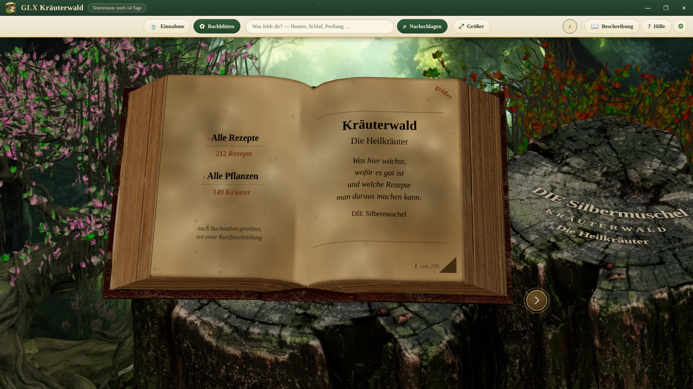
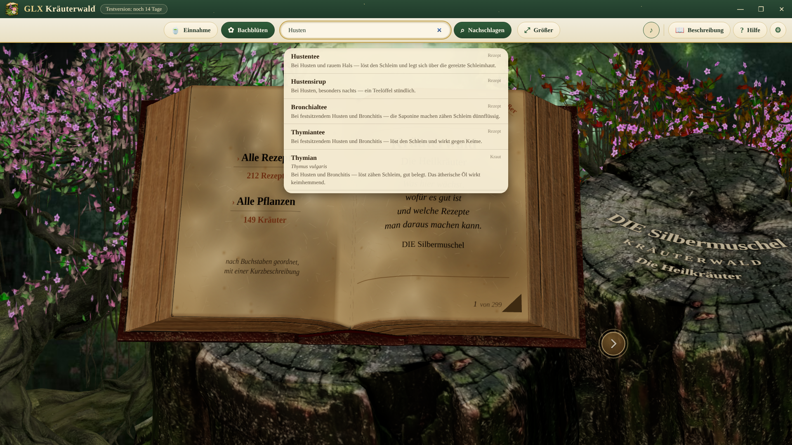
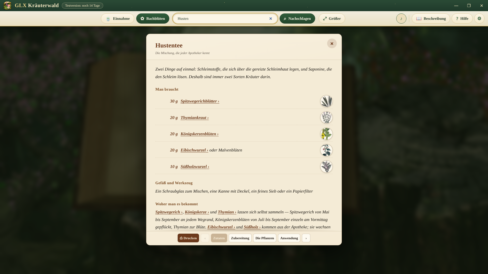
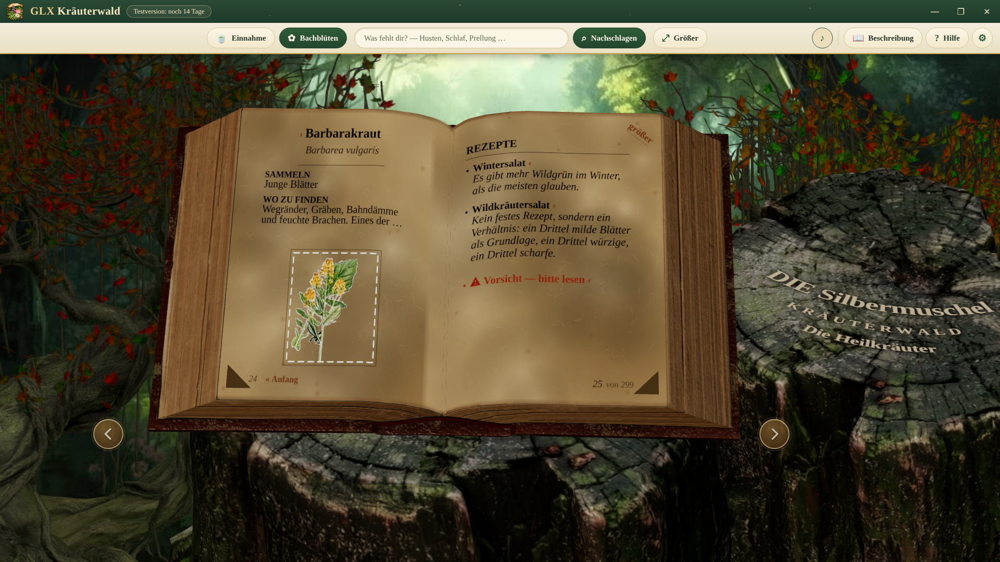
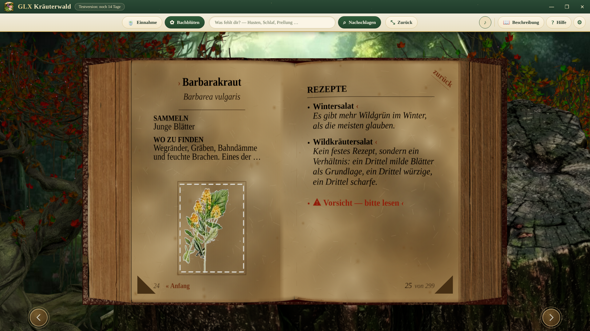
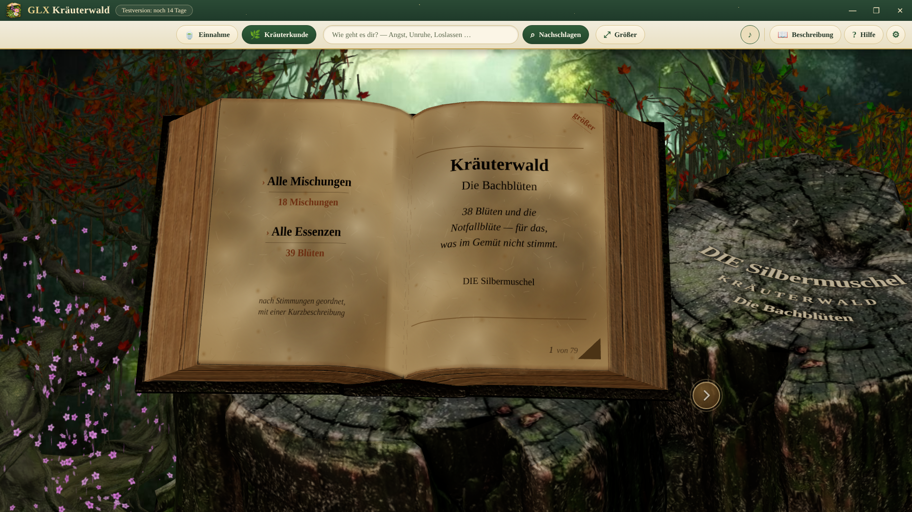
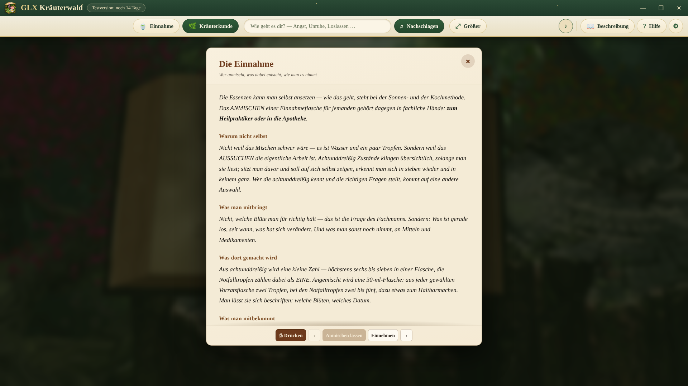
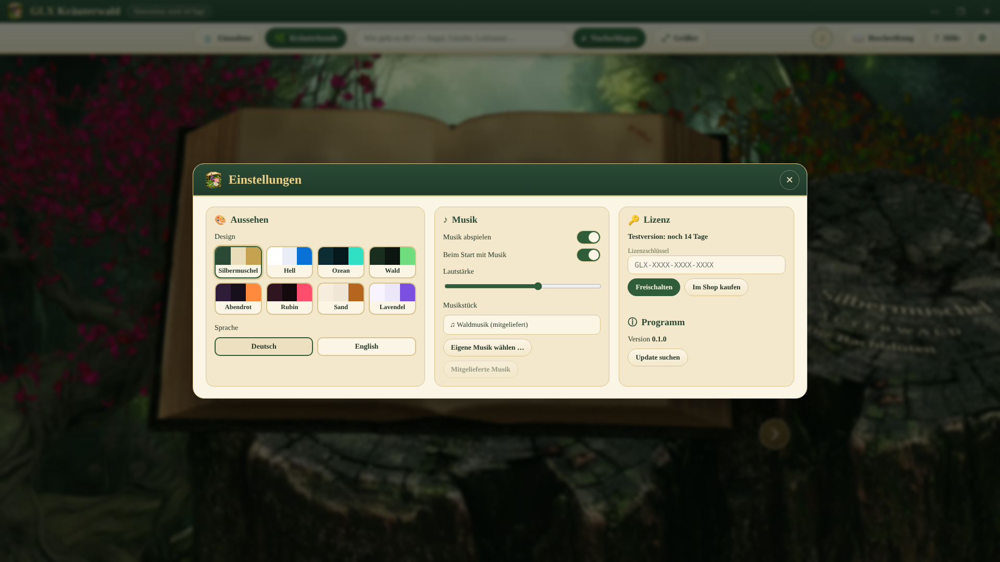
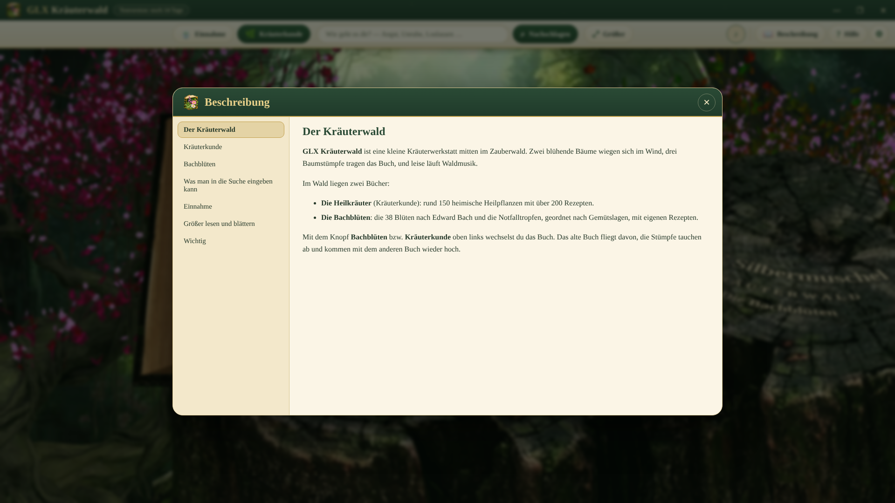

🌍 Sprachen: [🇺🇸 English](README.md) | [🇩🇪 Deutsch](README.de.md)

# 🌿 GLX Kräuterwald

### Kräuterkunde und Bachblüten als 3D-Buch im lebendigen Wald.

*149 Heilkräuter, über 200 Rezepte und alle Bachblüten, mit Suche nach Beschwerden.* 🌳

   

---

## ⬇️ Download

👉 Neueste Version: [Releases](../../releases/latest)  
👉 Shop und Lizenzen: [glx-tools.de](https://glx-tools.de/product/glx-kraeuterwald/)

---

## 📖 Überblick

GLX Kräuterwald bringt den Kräuterwald von DIE Silbermuschel als eigenes Programm auf deinen Windows-PC, ohne Browser und ohne Werbung. Die Oberfläche ist Deutsch und Englisch, die Bücher selbst sind auf Deutsch.

---

## 📸 Überblick & Screenshots

### 1️⃣ Der Kräuterwald mit dem aufgeschlagenen Buch

### 2️⃣ Suche nach Beschwerden

### 3️⃣ Rezeptfenster

### 4️⃣ Pflanzenseite mit Rezepten

### 5️⃣ Größer: das Buch gerade und groß

### 6️⃣ Das Bachblüten-Buch

### 7️⃣ Die Einnahme

### 8️⃣ Einstellungen mit 8 Designs und eigener Musik

### 9️⃣ Eingebaute Beschreibung

---

## ✨ Funktionen

- 🌳 **3D-Buch im lebendigen Wald:** Das Buch liegt auf einem Baumstumpf im animierten Wald, daneben wiegen sich zwei blühende Bäume im Wind.
- 🌿 **Kräuterkunde:** 149 Heilkräuter, jedes mit Bild, botanischem Namen, Wirkung, Sammelzeit und -ort und Anwendung.
- 🍵 **Über 200 Rezepte:** Tees, Tinkturen, Salben, Sirupe und Umschläge mit Haushaltsmaßen und nummerierten Schritten; Warnungen stehen zuerst.
- 🌸 **Bachblüten:** Alle 38 Blüten und die Notfalltropfen, nach Stimmungen geordnet, dazu 18 Mischungen und die Sonnen- und Kochmethode.
- 🔎 **Suche nach Beschwerden:** Husten, Schlaf, Prellung oder Angst eintippen, schon beim Tippen erscheinen passende Kräuter, Rezepte und Blüten.
- 📖 **Einfach blättern:** Große leuchtende Pfeile am Buch oder die Pfeiltasten; mit Größer holst du das Buch gerade nach vorn.
- 🔄 **Zwei Bücher, ein Knopf:** Wechsel zwischen Kräuterkunde und Bachblüten mit kurzer Wald-Animation.
- 💊 **Die Einnahme:** Erklärt, wie Tees, Tinkturen und Bachblüten eingenommen werden, zum Ausdrucken.
- 🎵 **Waldmusik:** Leise Musik mit eigener Lautstärke, oder deine eigene MP3 in Dauerschleife.
- 🎨 **8 Designs, DE/EN:** Große Knöpfe, Hinweise, eingebaute Hilfe, Oberfläche Deutsch und Englisch; 14 Tage kostenlos testen.

---

## 🧩 Systemanforderungen

- Windows 10 oder Windows 11 (64 Bit)
- Grafikkarte mit 3D-Unterstützung (WebGL)
- Microsoft-WebView2-Laufzeit (bei Windows 11 schon dabei)

---

## 🧪 Testzeitraum & Lizenz

14 Tage kostenlos mit allen Funktionen, danach Lizenz über [glx-tools.de](https://glx-tools.de/product/glx-kraeuterwald/).

---

## 🔐 Datenschutz

GLX Kräuterwald arbeitet auf deinem PC, alle Inhalte sind im Programm enthalten. Nur die Update-Suche fragt bei glx-tools.de nach einer neuen Version.

---

## ⚠️ Wichtiger Hinweis

Die Inhalte ersetzen keinen Arzt, Heilpraktiker oder Apotheker. Bei ernsten oder anhaltenden Beschwerden, in der Schwangerschaft und bei Kindern bitte immer fachlichen Rat einholen.

---

## 🔗 Mehr zu diesem Produkt

👉 [glx-tools.de](https://glx-tools.de/product/glx-kraeuterwald/)  
Support: **info@glx-tools.de**

---

## 📄 Lizenz

Copyright © 2026 GLX Tools – Gordon Lehmann. Alle Rechte vorbehalten.  
Dies ist proprietäre kommerzielle Software. Es wird keine Open-Source-Lizenz gewährt. Dieses Repository enthält nur Release-Downloads und Dokumentation; der Quelltext wird nicht veröffentlicht.

---

Mit ❤️ gemacht von **Dreamdancer100**

