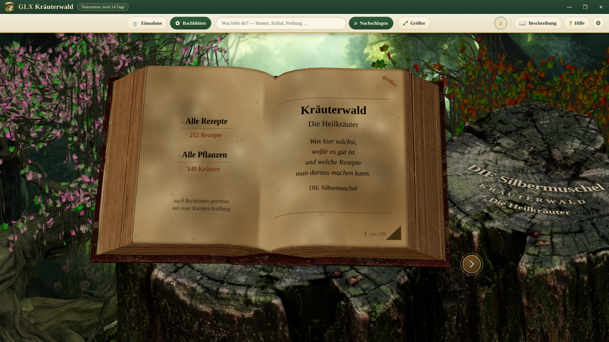
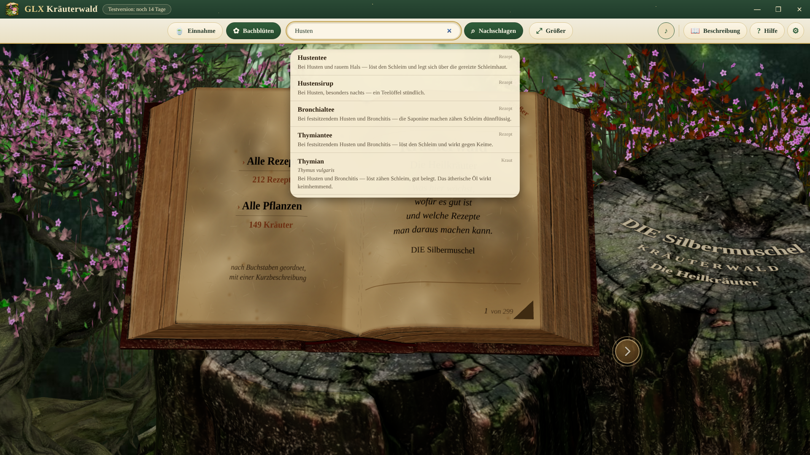
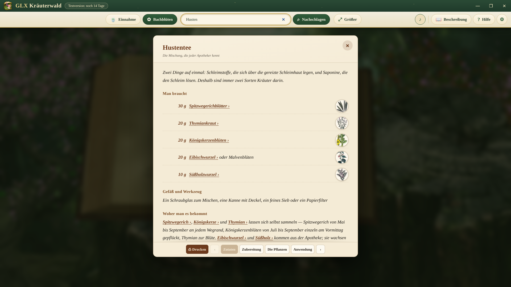
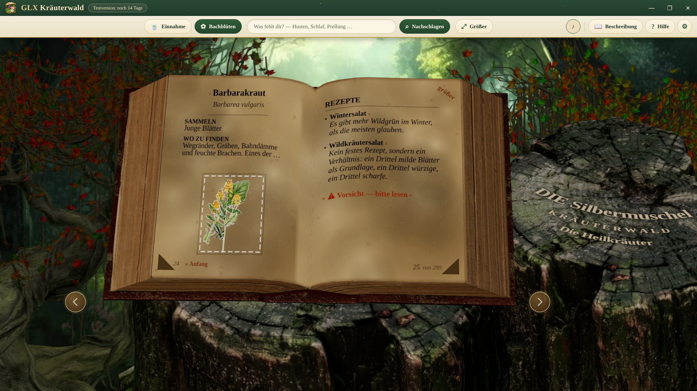
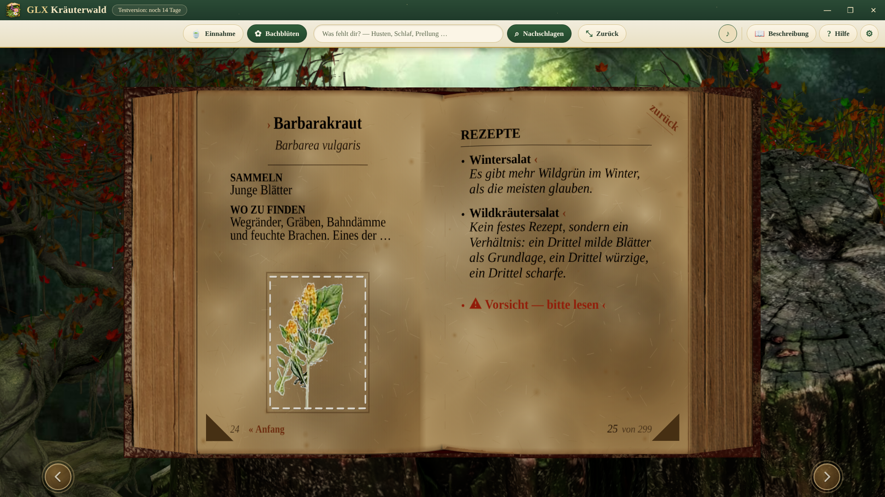
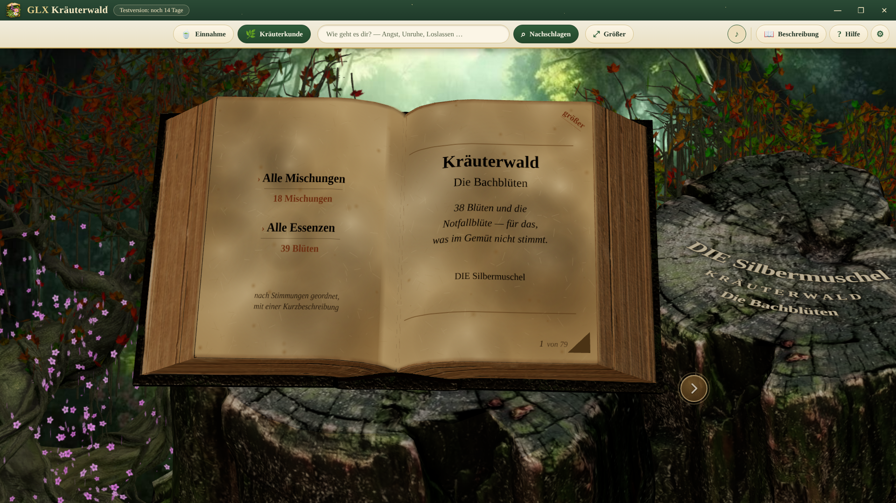
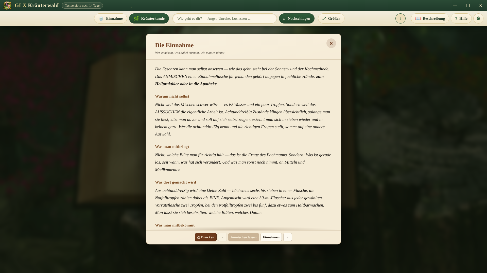
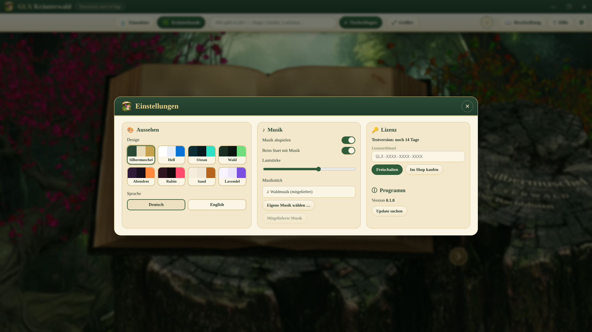
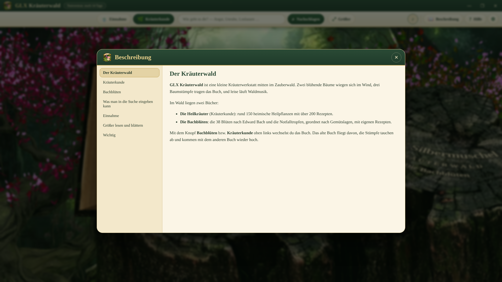

🌍 Languages: [🇺🇸 English](README.md) | [🇩🇪 Deutsch](README.de.md)

# 🌿 GLX Kräuterwald

### Herbal lore and Bach flowers as a 3D book in an animated forest.

*149 medicinal herbs, over 200 recipes and all Bach flowers, with search by complaint.* 🌳

   

---

## ⬇️ Download

👉 Latest version: [Releases](../../releases/latest)  
👉 Shop and licences: [glx-tools.de](https://glx-tools.de/product/glx-kraeuterwald/)

---

## 📖 About

GLX Kräuterwald brings the herb forest of DIE Silbermuschel to Windows as its own program, without browser and without ads. The interface is German and English; the book content is German for now (English follows with version 0.1.1).

---

## 📸 Overview & Screenshots

### 1️⃣ The herb forest with the open book

### 2️⃣ Search by complaint

### 3️⃣ Recipe window

### 4️⃣ Plant page with recipes

### 5️⃣ Bigger: the book straight and large

### 6️⃣ Bach flower book

### 7️⃣ Intake

### 8️⃣ Settings with 8 designs and own music

### 9️⃣ Built-in description

---

## ✨ Features

- 🌳 **3D book in a living forest:** The book lies on a tree stump in an animated forest with two blossoming trees swaying in the wind.
- 🌿 **Herbal lore:** 149 medicinal herbs, each with picture, botanical name, effect, when and where to collect it and how to use it.
- 🍵 **Over 200 recipes:** Teas, tinctures, salves, syrups and compresses with household measures and numbered steps; warnings come first.
- 🌸 **Bach flowers:** All 38 flowers plus Rescue Remedy, sorted by mood, with 18 blends and the sun and boiling methods.
- 🔎 **Search by complaint:** Type cough, sleep, bruise or anxiety and matching herbs, recipes and flowers appear while you type.
- 📖 **Easy to browse:** Large glowing arrows at the book or the arrow keys turn the pages; Bigger brings the book straight to the front.
- 🔄 **Two books, one button:** Switch between herbal lore and Bach flowers with a short forest animation.
- 💊 **Intake guide:** Explains how to take teas, tinctures and Bach flowers, printable.
- 🎵 **Forest music:** Gentle music with its own volume, or choose your own MP3 that plays in a loop.
- 🎨 **8 designs, DE/EN:** Large buttons, tooltips, built-in help, German and English interface; 14-day free trial.

---

## 🧩 Requirements

- Windows 10 or Windows 11 (64-bit)
- Graphics card with 3D support (WebGL)
- Microsoft WebView2 runtime (included in Windows 11)

---

## 🧪 Trial & License

14 days free with all features, then a licence from [glx-tools.de](https://glx-tools.de/product/glx-kraeuterwald/).

---

## 🔐 Privacy

GLX Kräuterwald works on your PC; all content is included in the program. Only the update check asks glx-tools.de for a new version.

---

## ⚠️ Note

The content does not replace a doctor, naturopath or pharmacist. For serious or lasting complaints, during pregnancy and for children always seek professional advice.

---

## 🔗 More about this product

👉 [glx-tools.de](https://glx-tools.de/product/glx-kraeuterwald/)  
For support: **info@glx-tools.de**

---

## 📄 License

Copyright © 2026 GLX Tools – Gordon Lehmann. All rights reserved.  
This is proprietary commercial software. No open-source license is granted. This repository contains release downloads and documentation only; the source code is not published.

---

Made with ❤️ by **Dreamdancer100**

